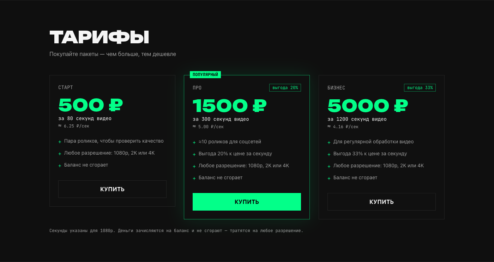
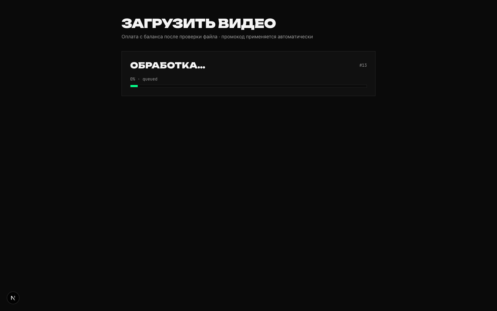
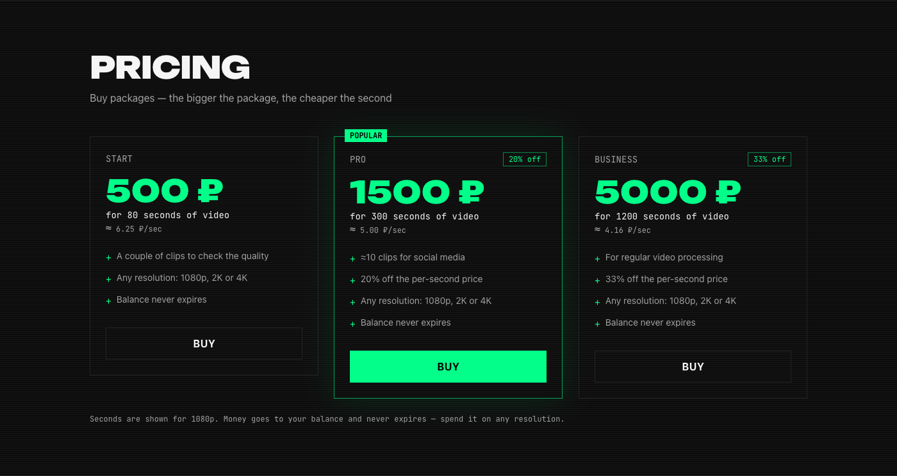

# Video Upscale

**Сервис повышения разрешения видео** (480p → 1080p / 2K / 4K) на базе API
[WaveSpeedAI](https://wavespeed.ai). Полноценный продукт с личным кабинетом,
внутренним балансом, промокодами, реферальной программой, платежами,
админ-панелью и асинхронной очередью обработки.

> 🔒 Исходный код закрыт (приватный репозиторий). Здесь — витрина продукта:
> возможности и скриншоты интерфейса.

**Стек:** Python 3.12 · FastAPI · SQLAlchemy 2.0 (async) · Next.js 16 · React 19 · TypeScript · Tailwind 4 · Docker Compose · Caddy

---

## Скриншоты

| Страница цен | Статус обработки заказа |
|---|---|
|  |  |

Локализация интерфейса — русский и английский:

| Pricing (EN) |
|---|
|  |

---

## Возможности

**Для пользователя**
- Регистрация и вход (JWT), восстановление пароля
- Загрузка видео, выбор разрешения, оплата с внутреннего баланса
- Отслеживание прогресса в реальном времени: `queued → uploading_to_api → processing → downloading → done`
- Скачивание результата, история заказов и транзакций
- Промокоды со скидкой и реферальная программа (бонус приглашающему при первом платеже)
- Уведомления о готовности — e-mail (SMTP) и Telegram
- Интерфейс на русском и английском, блог со статьями

**Для администратора**
- Все заказы с фильтрами по статусу, пользователю и периоду
- Управление пользователями (роль, баланс) и ценами по разрешениям
- Промокоды: создание, редактирование, статистика использования
- Аналитика: заказы, выручка и маржа за период
- Ручной возврат средств по завершённому заказу

---

## Как устроено

```
                    ┌──────────────┐
Internet ── 80/443 ─►│    Caddy     │  автоматический HTTPS (Let's Encrypt)
                    └──────┬───────┘
              ┌────────────┴────────────┐
              ▼                         ▼
     web:3000 (Next.js)      backend:8000 (FastAPI)
                                        │
                                        ▼
                                 SQLite + файлы
                                        ▲
                                        │
                              worker (очередь заказов)
```

Четыре сервиса в Docker Compose: `web`, `backend`, `worker`, `caddy`. API и
обработчик очереди — один образ в разных процессах, данные на общем томе.

**Ключевые решения**

- **Очередь без внешнего брокера.** Воркер атомарно забирает заказ
  (`UPDATE ... WHERE status='queued'`), поэтому задача не обрабатывается дважды.
- **Надёжность.** Транзиентные ошибки провайдера (5xx/429) повторяются с backoff
  2/5/15 с. Если обработка всё же упала — заказ помечается `failed`, деньги
  автоматически возвращаются на баланс, пользователь получает уведомление.
  При рестарте «зависшие» заказы возвращаются в очередь.
- **Экономия на внешнем API.** Видео длиннее 10 минут обрезается через
  `ffmpeg -c copy` (без перекодирования) — провайдеру уходит только нужная часть.
- **Провайдер за интерфейсом.** Реализации `mock` и `wavespeed` за одним базовым
  классом: весь пайплайн тестируется end-to-end без API-ключа.
- **Биллинг.** Баланс, транзакции, промокоды и реферальные начисления — отдельный
  слой сервисов с шестишаговой валидацией промокода.
- **Автоочистка хранилища.** Фоновая задача удаляет файлы старше 24 часов, чтобы
  диск не переполнялся.

**Тесты.** 11 модулей pytest покрывают не только happy-path, но и ошибочные
сценарии: дубликат email, неверный пароль, нехватка баланса, доступ к чужому
заказу, превышение размера файла, невалидный промокод, доступ к админским ручкам
без роли, авто-возврат средств при сбое обработки.

---

## Статус

Продукт собран и разворачивается на VPS одной командой (`docker compose up -d --build`),
HTTPS настраивается автоматически через Caddy.

---

*Демонстрация возможностей. Полный исходный код доступен по запросу.*
